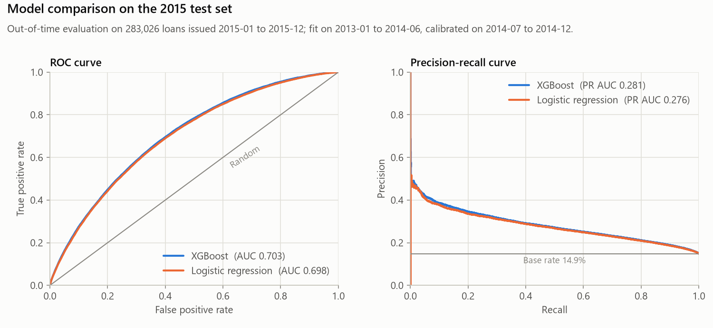
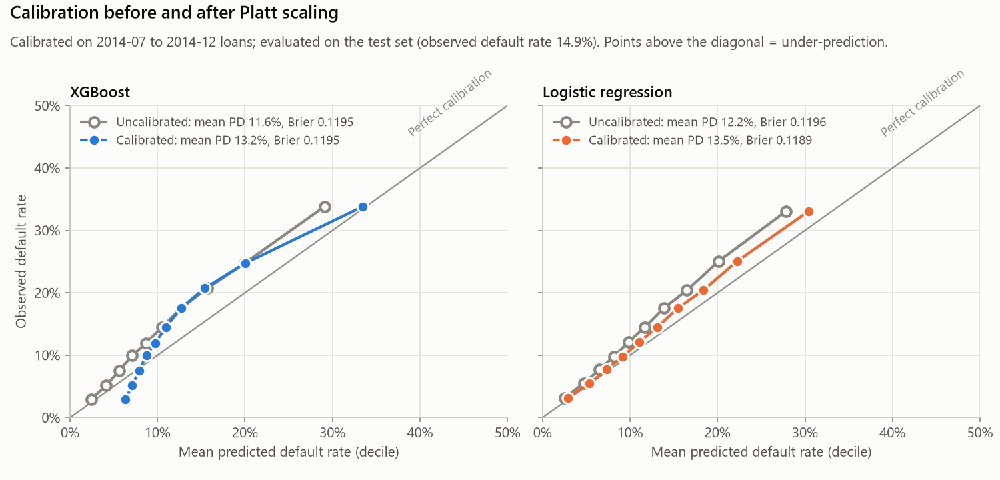
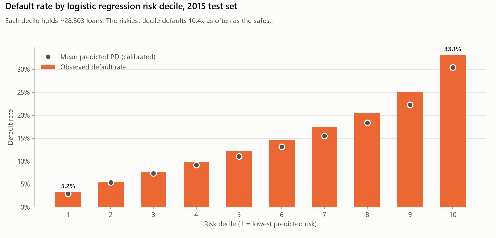
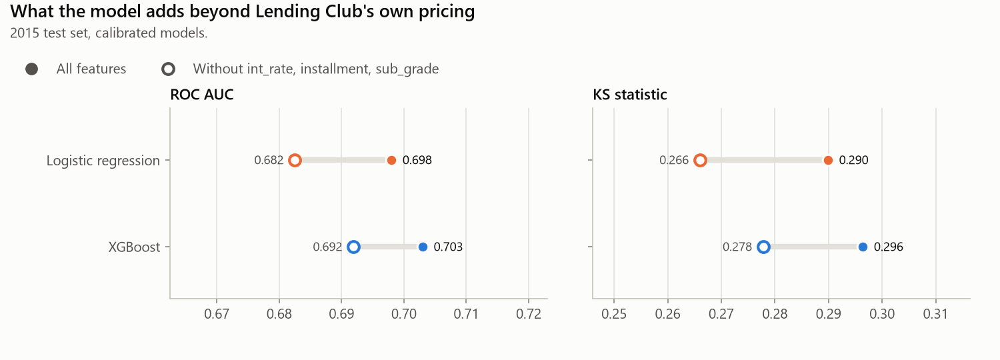

# Credit Risk Forecasting: Lending Club default model

[](https://github.com/Yigituysgl/Credit-Risk-Forecasting-System/actions/workflows/tests.yml)

Predicts the probability that a Lending Club consumer loan is charged off,
using only information available when the loan application is decided, and
evaluates it out of time on loans issued in a later year.

All numbers below are produced by the code in this repository and stored in
[`reports/metrics.json`](reports/metrics.json) and
[`reports/evaluation.json`](reports/evaluation.json).

## The problem with the original version

An earlier version of this project reported a ROC AUC of 0.995. That number
was not real:

- **Target leakage.** The model used post-outcome fields such as `recoveries`,
  `total_pymnt`, `total_rec_prncp`, `last_pymnt_amnt`, `out_prncp` and the
  refreshed `last_fico_*` scores. These are recorded *after* the loan is issued
  and effectively encode whether it defaulted.
- **Random split.** Train and test were a random 80/20 split of the same years,
  and imputation and scaling were fitted on all rows before the split.
- **Wrong labels.** Loans still running (`Current`, in grace period, early
  late stages) were labelled as non-defaults.

What changed:

- Only application-time features; every one of the 151 raw columns is either
  used or excluded with a written reason, and the training run fails if a new
  column appears unaccounted for.
- Out-of-time split by issue date; all preprocessing is fitted on the training
  period only, inside a scikit-learn pipeline.
- Target defined on finished loans only: `Charged Off`/`Default` vs `Fully Paid`.
- Probability calibration on a later slice of the training period.
- Tests (pytest, synthetic data) running in GitHub Actions.

## Data

- **Source:** Lending Club accepted loans 2007-2018Q4, file
  `accepted_2007_to_2018Q4.csv` from the Kaggle dataset
  [All Lending Club loan data](https://www.kaggle.com/datasets/wordsforthewise/lending-club).
  The data is not included in this repository.
- **Finished loans only:** a loan is kept if its term plus a 3-month buffer
  ended before the data snapshot (March 2019) and its status is final.
  This prevents recent cohorts from being dominated by loans that resolved early.
- **Window:** 2013 onward, because most credit-bureau fields are missing
  before mid-2012.

| Period | Issue dates | Loans | Default rate |
|---|---|---|---|
| Model fit | 2013-01 to 2014-06 | 206,759 | 14.77% |
| Calibration | 2014-07 to 2014-12 | 90,615 | 14.13% |
| Test (out of time) | 2015-01 to 2015-12 | 283,026 | 14.89% |

## Features

65 features, all known when the application is decided:

- **Applicant and loan:** loan amount, annual income, debt-to-income ratio,
  term, employment length, home ownership, purpose, income verification status.
- **Credit bureau at application:** FICO score, delinquencies, inquiries,
  revolving balance and utilisation, account counts, months since recent
  events, and similar attributes.
- **Lending Club pricing:** interest rate, instalment and sub-grade.
- **Engineered:** credit history length in months (from `earliest_cr_line`).

84 columns are excluded, each with a reason, in
[`credit_risk/features.py`](credit_risk/features.py) (also listed under
`excluded` in [`reports/metrics.json`](reports/metrics.json)). They include
all post-outcome payment, hardship and settlement fields; fields only known
after approval (`funded_amnt`, `initial_list_status`); joint-application and
bureau fields that only appear from late 2015; and free text and identifiers.
**Geography (`zip_code`, `addr_state`) is excluded** because location can act
as a proxy for protected characteristics, which creates fair-lending risk.

## Results

Calibrated logistic regression is the headline model; XGBoost is the comparison.
Both use fixed hyperparameters (no tuning) and are evaluated on the 2015 test set.

| Model (calibrated) | ROC AUC | PR AUC | KS | Brier | Mean predicted PD | Actual default rate |
|---|---|---|---|---|---|---|
| **Logistic regression** | 0.6980 | 0.2763 | 0.2899 | 0.1189 | 13.54% | 14.89% |
| XGBoost | 0.7030 | 0.2815 | 0.2964 | 0.1195 | 13.24% | 14.89% |

Logistic regression is chosen because it ranks loans almost as well as XGBoost
(ROC AUC 0.698 vs 0.703), has the better Brier score, and is easier to explain.









### Key findings

- **Risk separation.** Ranking the 2015 loans by the logistic regression
  score, the riskiest tenth defaulted at 33.07% and the safest tenth at
  3.18%: **10.4×** as often.
- **Drift within grades in 2015.** Comparing 36-month loans, default rates per
  Lending Club grade were higher in 2015 than in 2013-2014 (B 10.32% → 11.90%,
  C 16.51% → 19.44%, D 21.44% → 26.22%, E 25.86% → 32.84%). Models trained on
  earlier years therefore under-predict 2015 defaults.
- **Calibration helps only partly.** Platt scaling on 2014 H2 raised the mean
  predicted PD of logistic regression from 12.18% to 13.54% (actual 14.89%)
  and improved the Brier score from 0.1196 to 0.1189. For XGBoost it raised the
  mean from 11.60% to 13.24% but left the Brier score at 0.1195.
- **Most of the signal comes from application and bureau data.** Removing
  Lending Club's own pricing (`int_rate`, `installment`, `sub_grade`) lowers
  ROC AUC from 0.6980 to 0.6825 for logistic regression and from 0.7030 to
  0.6919 for XGBoost.

## Limitations

- **Single run, no confidence intervals.** Differences of a few thousandths in
  AUC between the models should not be over-read.
- **Calibration only partly corrects the 2015 drift.** Both models still
  under-predict the 2015 default rate (13.54% and 13.24% vs 14.89%).
- **Scope.** US consumer loans issued 2013-2015 on one platform; results may
  not transfer to other lenders, products or economic conditions.
- **Test set is 36-month loans only.** 60-month loans issued in 2015 had not
  finished by the data snapshot, so the model is not evaluated on them.
- **No hyperparameter tuning.** Settings were fixed in advance.

## Setup and reproduce

Requires Python 3.11 and the CSV downloaded from Kaggle (about 1.7 GB).

```bash
python -m venv .venv
source .venv/bin/activate        # Windows: .venv\Scripts\activate
pip install -r requirements.txt
export LENDING_CLUB_CSV=/path/to/accepted_2007_to_2018Q4.csv   # Windows: set LENDING_CLUB_CSV=...

python train.py --data "$LENDING_CLUB_CSV"        # fits models, writes reports/metrics.json
python make_report.py --data "$LENDING_CLUB_CSV"  # writes docs/*.png and reports/evaluation.json
pytest                                           # synthetic data, no CSV needed
```

`make_report.py` stops with an error if the saved models do not reproduce
`reports/metrics.json`. The EDA notebook [`eda.ipynb`](eda.ipynb) reads the
data path from `LENDING_CLUB_CSV`.

```
credit_risk/      features (with exclusion reasons), loading, target, split, models
train.py          training and evaluation
make_report.py    charts and evaluation.json from the saved models
eda.ipynb         short exploratory analysis
reports/          metrics.json, evaluation.json
docs/             charts
tests/            pytest suite (synthetic data)
```

## Author

Yigit Uysaloglu ·
[LinkedIn](https://www.linkedin.com/in/yigit-uysaloglu/) ·
[GitHub](https://github.com/Yigituysgl)

## License

[MIT](LICENSE)
